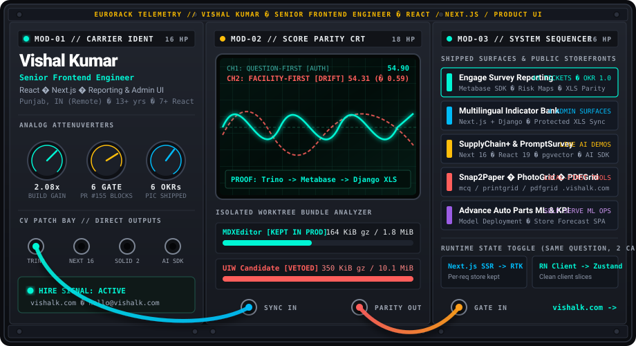

  

  <a href="https://vishalk.com"><strong>vishalk.com</strong></a> ·
  <a href="https://vishalk.com/work"><strong>Work Dossiers</strong></a> ·
  <a href="https://vishalk.com/resume"><strong>Resume (PDF)</strong></a> ·
  <a href="mailto:hello@vishalk.com"><strong>hello@vishalk.com</strong></a> ·
  <a href="https://www.linkedin.com/in/vishalkdotcom"><strong>LinkedIn</strong></a>

---

### `PATCH NOTES // VERIFIED ARCHITECTURE SIGNALS`

| Patch | Signal | Counterexample / Benchmark Proof | Shipped Architecture |
| :--- | :--- | :--- | :--- |
| **`CH-01`** | **One Scoring Authority** (`WPM-3469`) | Proved `facility-first` (**54.31**) vs `question-first` (**54.90**) diverged across 8 unequal-volume sites (**71.47 vs 71.40** on 2 sites). | Trino/Metabase cards became the single scoring authority; Django validates, pivots, and writes XLS with zero duplicate math. |
| **`CH-02`** | **Next.js 16 + De-Barrel** (`WPM-3019`) | Quiet-machine `hyperfine` production build: **`84.5s ± 11.4s → 40.6s`** (**2.08× faster**). | Self-initiated Next.js 16 upgrade, barrel-file removal, and cached CI pipeline alongside legacy CRA. |
| **`CH-03`** | **The Confident "No"** (`WPM-3487`) | Isolated worktree production build: candidate emitted **350 KiB gzip** (**10.1 MiB** install) vs MDXEditor's **164 KiB gzip** (**1.8 MiB**). | Vetoed the rewrite when real build output contradicted the "lighter alternative" pitch. |
| **`CH-04`** | **Context-Driven State** | Same engineer, two runtimes, opposite calls: Next.js SSR per-request store negated Zustand DX vs React Native client runtime. | Kept **Redux Toolkit** on Next.js web; adopted **Zustand** on the React Native Moodle/SCORM POC. |
| **`CH-05`** | **Review Gatekeeper** (`PR #155`) | Caught **6 merge-blocking bugs** on Card 7 migration (brand-only score lock, swapped `question_type` `1` & `3`, zeroed API guard, stale client filter, repo-wide `@ts-ignore`). | Delivered file/line-referenced merge checklist inside the 43-ticket Engage Reporting OKR (`0.5 → 1.0`). |

---

### `SEQUENCER PADS // LIVE STOREFRONTS & PRODUCTION DOSSIERS`

| Pad | Surface | Stack | Access |
| :--- | :--- | :--- | :--- |
| **`PAD-01`** | **SupplyChain+** — Explainable supplier-risk scoring, complaint clustering & audit export | `Next.js 16` `React 19` `pgvector` `Drizzle` `Vercel AI SDK` | [**sc-plus.vercel.app →**](https://sc-plus.vercel.app) |
| **`PAD-02`** | **PromptSurvey** — Prompt-to-survey builder, per-question AI regen & multilingual translation | `Next.js 15` `React 19` `Vercel AI SDK` `Zod` `IndexedDB` | [**qgenai.vercel.app →**](https://qgenai.vercel.app) |
| **`PAD-03`** | **Snap2Paper · PhotoGrid · PDFGrid** — Local-first vision MCQ digitizer, passport layout & N-up PDF compiler | `TypeScript` `Gemini Vision` `Canvas` `Client-side PDF` | [**mcq**](https://mcq.vishalk.com/) · [**printgrid**](https://printgrid.vishalk.com/) · [**pdfgrid**](https://pdfgrid.vishalk.com/) |
| **`PAD-04`** | **Engage Reporting & Multilingual Indicator Bank** *(Labor Solutions)* | `Next.js` `React` `TypeScript` `Metabase SDK` `Django` `Trino` | [**Case Dossiers on vishalk.com →**](https://vishalk.com/work) |
| **`PAD-05`** | **Model Deployment Framework & Store KPIs** *(Advance Auto Parts)* | `Next.js` `TypeScript` `Tremor/Nivo` `Snowflake` `Streamlit` | [**Case Dossiers on vishalk.com →**](https://vishalk.com/work) |
