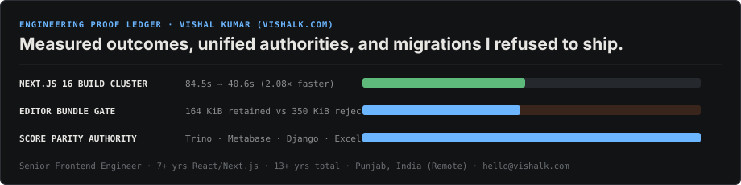

# Variant 2 — The Engineering Proof Ledger

<!-- Deploy: copy this file to /README.md or run `node scripts/use-variant.mjs 2` -->

<picture>
  <source media="(prefers-color-scheme: dark)" srcset="../../assets/v2-ledger-dark.svg" />
  <source media="(prefers-color-scheme: light)" srcset="../../assets/v2-ledger-light.svg" />
  
</picture>

### `§01` Measured Decisions & Architectural Reversals

| ID | System | Finding / Intervention | Measured Delta | Outcome |
| :--- | :--- | :--- | :--- | :--- |
| **`ARCH-01`** | **Engage Reporting** · *Trino / Metabase / Django / Next.js* | Executive dashboards averaged facility scores while Excel exports averaged respondent rows, causing silent drift on uneven site sample sizes. | **100% score parity** across UI & Excel | Analytics cards established as single source of scoring truth |
| **`PERF-02`** | **WPM Platform** · *Next.js 16 / CI Pipeline* | Upgraded Next.js 16 across 107 files, eliminated barrel-file imports (`optimizePackageImports`), and repaired Docker/CI layer caching. | **`84.5s → 40.6s`** (`2.08×` faster build) | Adopted in production; cut CI feedback cycle in half |
| **`BUND-03`** | **Survey Authoring** · *Rich-Text Editor Evaluation* | Built isolated production build comparing candidate rich-text editor against incumbent under lazy chunk loading. | **`164 KiB` vs `350 KiB`** (`-186 KiB` gzip) | **Halted migration**; saved multi-sprint rewrite |
| **`STAT-04`** | **Client State Layer** · *Redux vs. Zustand POC* | Prototyped slice migration and scoped 7–13h rollout, then audited SSR/hydration boundary interactions in Next.js. | **Net complexity > payoff** | **Reversed own proposal**; retained existing boundary |
| **`SYNC-05`** | **Indicator Bank** · *Cross-Service Sync* | Caught ID-decoding edge case on cloned template rows during cross-service indicator synchronization. | **45 regression tests** | Narrowed sync contract to prevent silent data corruption |

---

### `§02` Shipped Work & Public Storefronts

<b>Production Dossiers — Enterprise Platforms (Labor Solutions & Advance Auto Parts)</b>

 

- **[WFP Engage Reporting](https://vishalk.com/work/engage-reporting)** — Multi-tab workforce survey reporting (`Summary`, `Categories`, `Miscellaneous`) combining native UI cards with embedded Metabase analytics, site-risk heatmaps, and unified Excel export parity.
- **[Multilingual Indicator Bank](https://vishalk.com/work/indicator-bank)** — Four-tab taxonomy and question bank (`Indicators`, `Questions`, `Answer Sets`, `Manage Associations`) across Django & Next.js with protected Excel round-trip import/export.
- **[Store Measurement Framework](https://vishalk.com/work/measurement-framework)** — Store KPI measurement and cohort comparison workbench built on Next.js, TypeScript, Tremor/Nivo, and Snowflake.
- **[Model Deployment Framework](https://vishalk.com/work/model-deployment-framework)** & **[Store Performance Dashboard](https://vishalk.com/work/store-dashboard)** — Self-service ML model hosting interface and store-level sales forecasting tools.

<b>Public Storefronts — Local-First Tools & AI Prototypes (Zero Sign-In)</b>

 

- **[Snap2Paper (`mcq.vishalk.com`)](https://mcq.vishalk.com/)** — Gemini vision digitizer that turns photographed exam sheets into editable MCQ study sets and print-ready PDFs. · *[Case →](https://vishalk.com/work/snap2paper)*
- **[PhotoGrid (`printgrid.vishalk.com`)](https://printgrid.vishalk.com/)** — Browser-local passport, visa, and stamp photo sheet composer for A4 and 4×6 paper with precision cut guides. · *[Case →](https://vishalk.com/work/photogrid)*
- **[PDFGrid (`pdfgrid.vishalk.com`)](https://pdfgrid.vishalk.com/)** — Client-side N-up PDF compiler (`2×2`, `2×3`, `3×3` presets, margins, gutters, page ranges) with zero server uploads. · *[Case →](https://vishalk.com/work/pdfgrid)*
- **[SupplyChain+ (`sc-plus.vercel.app`)](https://sc-plus.vercel.app)** — Supplier risk scoring, pgvector complaint clustering, and compliance audit pack generator. · *[Case →](https://vishalk.com/work/supplychain-plus)*
- **[PromptSurvey (`qgenai.vercel.app`)](https://qgenai.vercel.app)** — Prompt-to-survey generator with per-question AI regeneration and multi-language translation. · *[Case →](https://vishalk.com/work/promptsurvey)*

---

  <a href="https://vishalk.com"><code>◈ vishalk.com</code></a> ·
  <a href="https://vishalk.com/resume"><code>◱ Resume PDF</code></a> ·
  <a href="https://vishalk.com/contact"><code>◇ Contact</code></a> ·
  <a href="https://www.linkedin.com/in/vishalkdotcom"><code>↗ LinkedIn</code></a>

