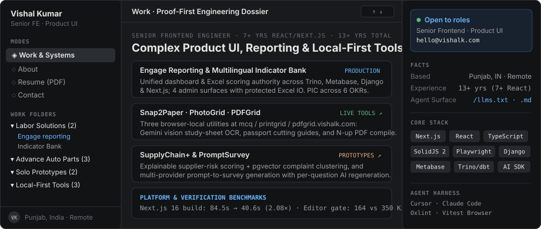

# Variant 3 — Triptych Bento App-Shell

<!-- Deploy: copy this file to /README.md or run `node scripts/use-variant.mjs 3` -->

<a href="https://vishalk.com">
  <picture>
    <source media="(prefers-color-scheme: dark)" srcset="../../assets/v3-triptych-dark.svg" />
    <source media="(prefers-color-scheme: light)" srcset="../../assets/v3-triptych-light.svg" />
    
  </picture>
</a>

<table width="100%">
  <tr>
    <td width="33%" valign="top">
      <h4><code>01</code> · Enterprise Platforms</h4>
      
<b>Labor Solutions &amp; AAP</b>

      <ul>
        <li><a href="https://vishalk.com/work/engage-reporting">WFP Engage Reporting</a></li>
        <li><a href="https://vishalk.com/work/indicator-bank">Multilingual Indicator Bank</a></li>
        <li><a href="https://vishalk.com/work/measurement-framework">Store Measurement UI</a></li>
        <li><a href="https://vishalk.com/work/model-deployment-framework">ML Model Deployment</a></li>
        <li><a href="https://vishalk.com/work/store-dashboard">Store Forecast Dashboard</a></li>
      </ul>
    </td>
    <td width="33%" valign="top">
      <h4><code>02</code> · Local-First Utilities</h4>
      
<b>Zero-Upload Browser Tools</b>

      <ul>
        <li><a href="https://mcq.vishalk.com/"><b>Snap2Paper</b></a> — Vision MCQ digitizer &amp; PDF sheet builder</li>
        <li><a href="https://printgrid.vishalk.com/"><b>PhotoGrid</b></a> — Passport &amp; ID sheet layout on A4 / 4×6</li>
        <li><a href="https://pdfgrid.vishalk.com/"><b>PDFGrid</b></a> — Client-side N-up PDF page compiler</li>
      </ul>
    </td>
    <td width="34%" valign="top">
      <h4><code>03</code> · Applied AI Prototypes</h4>
      
<b>End-to-End Vertical Slices</b>

      <ul>
        <li><a href="https://sc-plus.vercel.app"><b>SupplyChain+</b></a> — pgvector complaint clustering &amp; risk scoring</li>
        <li><a href="https://qgenai.vercel.app"><b>PromptSurvey</b></a> — Prompt-to-survey builder with i18n translation</li>
        <li><a href="https://vishalk.com/resume"><b>Resume &amp; Dossier</b></a> · <a href="https://vishalk.com/contact"><b>Contact</b></a></li>
      </ul>
    </td>
  </tr>
</table>
