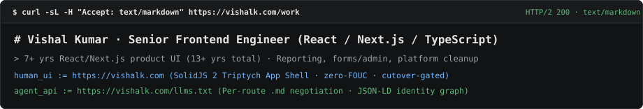

# Variant 4 — Dual-Legibility Protocol (`Accept: text/markdown`)

<!-- Deploy: copy this file to /README.md or run `node scripts/use-variant.mjs 4` -->

<picture>
  <source media="(prefers-color-scheme: dark)" srcset="../../assets/v4-protocol-dark.svg" />
  <source media="(prefers-color-scheme: light)" srcset="../../assets/v4-protocol-light.svg" />
  
</picture>

```yaml
id: vishal-kumar
role: Senior Frontend Engineer
location: India (UTC+05:30)
web: https://vishalk.com
agent_manifest: https://vishalk.com/llms.txt
workstation: chezmoi init --apply vishalkdotcom

focus:
  - Reporting platforms & multi-grain analytics parity (Next.js, TypeScript, Trino, Metabase, Django)
  - Multilingual authoring workflows & protected Excel round-trip pipelines
  - Local-first browser utilities (PDF/canvas layout compilation, Gemini vision digitization)

verified_benchmarks:
  score_parity: "Unified dashboard & Excel scoring grain across Trino, Metabase, Django, and Next.js"
  nextjs_16_pipeline: "84.5s -> 40.6s (2.08x faster clean production build across 107 files)"
  bundle_gate: "Halted rich-text editor migration after measuring 350 KiB vs 164 KiB lazy gzip JS"

public_storefronts:
  snap2paper:     https://mcq.vishalk.com/
  photogrid:      https://printgrid.vishalk.com/
  pdfgrid:        https://pdfgrid.vishalk.com/
  supplychain+:   https://sc-plus.vercel.app
  promptsurvey:   https://qgenai.vercel.app

case_dossiers:
  engage_reporting:          https://vishalk.com/work/engage-reporting
  indicator_bank:            https://vishalk.com/work/indicator-bank
  measurement_framework:     https://vishalk.com/work/measurement-framework
  model_deployment:          https://vishalk.com/work/model-deployment-framework
  store_dashboard:           https://vishalk.com/work/store-dashboard
```

### Query Directly from Terminal

```bash
# Fetch structured Markdown dossier for any route
curl -sL -H "Accept: text/markdown" https://vishalk.com/work
curl -sL https://vishalk.com/llms.txt
```
