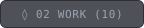
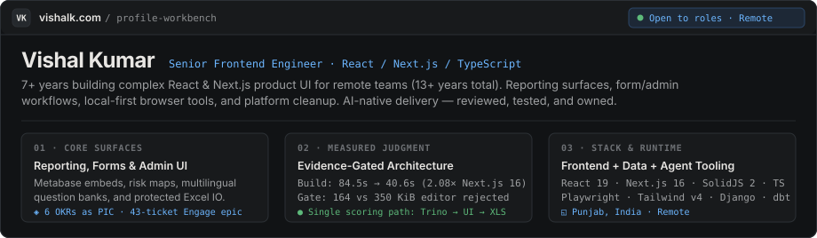

# Variant 5 — Multi-Tab Interactive Repository Dossier

<!-- Deploy: copy this file to /README.md or run `node scripts/use-variant.mjs 5` -->

  
  
  
  

<picture>
  <source media="(prefers-color-scheme: dark)" srcset="../../assets/v1-workbench-dark.svg" />
  <source media="(prefers-color-scheme: light)" srcset="../../assets/v1-workbench-light.svg" />
  
</picture>

<table width="100%">
  <tr>
    <td width="50%" valign="top">
      <h4><a href="../../WORK.md"><code>◊ 02 WORK INVENTORY →</code></a></h4>
      
<b>10 Shipped Systems across 4 Folders</b>

      <ul>
        <li><b>Labor Solutions</b>: <a href="https://vishalk.com/work/engage-reporting">WFP Engage Reporting</a> &amp; <a href="https://vishalk.com/work/indicator-bank">Multilingual Indicator Bank</a></li>
        <li><b>Advance Auto Parts</b>: <a href="https://vishalk.com/work/measurement-framework">Measurement Framework</a>, <a href="https://vishalk.com/work/model-deployment-framework">Model Deployment</a>, <a href="https://vishalk.com/work/store-dashboard">Store Forecast</a></li>
        <li><b>Local-First Tools</b>: <a href="https://mcq.vishalk.com/">Snap2Paper</a>, <a href="https://printgrid.vishalk.com/">PhotoGrid</a>, <a href="https://pdfgrid.vishalk.com/">PDFGrid</a></li>
        <li><b>AI Prototypes</b>: <a href="https://sc-plus.vercel.app">SupplyChain+</a>, <a href="https://qgenai.vercel.app">PromptSurvey</a></li>
      </ul>
    </td>
    <td width="50%" valign="top">
      <h4><a href="../../DECISIONS.md"><code>◱ 03 MEASURED DECISIONS →</code></a></h4>
      
<b>Verified Production Interventions &amp; Reversals</b>

      <ul>
        <li><b>Score Parity Authority</b>: Unified facility vs. respondent grain across Trino, Metabase, Django &amp; Next.js</li>
        <li><b>Next.js 16 Pipeline</b>: <code>84.5s → 40.6s</code> (<code>2.08×</code>) clean production build across 107 files</li>
        <li><b>Bundle Gate Reversal</b>: Halted editor migration after measuring <code>350 KiB</code> vs <code>164 KiB</code> lazy gzip JS</li>
        <li><b>State POC Reversal</b>: Scoped 7–13h Zustand POC, then retained Redux boundary on net-benefit review</li>
      </ul>
    </td>
  </tr>
</table>

  <a href="https://vishalk.com"><b>vishalk.com</b></a> ·
  <a href="https://vishalk.com/resume">Resume PDF</a> ·
  <a href="https://vishalk.com/contact">Contact</a> ·
  <a href="https://www.linkedin.com/in/vishalkdotcom">LinkedIn</a> ·
  <a href="../../STACK.md">Stack &amp; Dotfiles</a>

